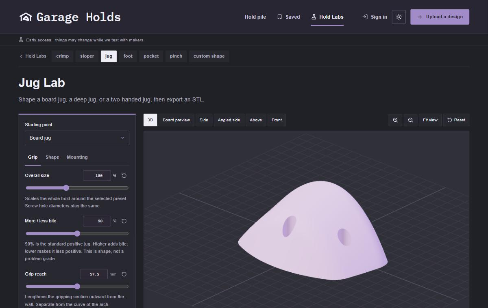

# Garage Holds

Free, open-source tools for designing 3D printable climbing holds for home walls and training boards. Pick a hold type, drag sliders for size, incut and depth, check the 3D preview, and export an STL ready to slice. The bolt hole, washer recess and set-screw holes are sized for standard climbing hardware.

**Try it at [garageholds.com/make](https://garageholds.com/make).** It runs in the browser, and exporting needs no account.

## The labs

| Lab                                                       | What it makes                                                                 |
| --------------------------------------------------------- | ----------------------------------------------------------------------------- |
| [Crimp](https://garageholds.com/make/crimp)               | Edges with adjustable depth, incut and lip rounding                           |
| [Sloper](https://garageholds.com/make/sloper)             | Rounded holds with broad curves for open-hand grip                            |
| [Jug](https://garageholds.com/make/jug)                   | Board, deep, rail and two-handed jugs                                         |
| [Foot](https://garageholds.com/make/foot)                 | Board edges, toe-in edges, chips, smears, balls and dishes (experimental)     |
| [Pocket](https://garageholds.com/make/pocket)             | Mono, two- and three-finger pockets (experimental)                            |
| [Pinch](https://garageholds.com/make/pinch)               | Blocks to squeeze, with lean, undercut and offset on each side (experimental) |
| [Custom Shape](https://garageholds.com/make/custom-shape) | Paint your own silhouette and turn it into a hold (being reworked)            |

Every lab keeps its settings in the address bar, so a Copy link button shares the exact hold.

The site also has a [library](https://garageholds.com) where people share holds they've designed or printed, with print settings and reviews, and a [printing guide](https://garageholds.com/how-to-3d-print-climbing-holds).

## The files you make are yours

STLs you export from the labs are yours to print, share, sell or remix however you like. The license below covers this code, not the holds it generates. Printed holds take real loads: check your prints and hardware before you trust them on a wall.

## How it works

The hold geometry is Python, in [`tools/`](tools) (one generator per lab, sharing one engine), and runs on the site as Vercel Python functions. The website is Next.js and TypeScript, with Supabase for accounts and the library and Cloudflare R2 for files.

To run it locally, with or without the Python generators, see [docs/development.md](docs/development.md). Each generator also has its own local browser GUI, described in its README (for example [the crimp generator](tools/crimp-generator/README.md)).

## Contributing

Bug reports, hold-type requests and pull requests are welcome: [open an issue](https://github.com/rileywhy/garage-holds/issues). If you've printed holds from the labs, photos and notes on what held up (and what didn't) help the most.

## License

[GNU Affero General Public License v3.0](LICENSE). You can use, modify and share this code; if you run a modified version as a website, you must publish your changes under the same license. The fonts in `public/fonts` are under the SIL Open Font License, with their license files alongside them.
